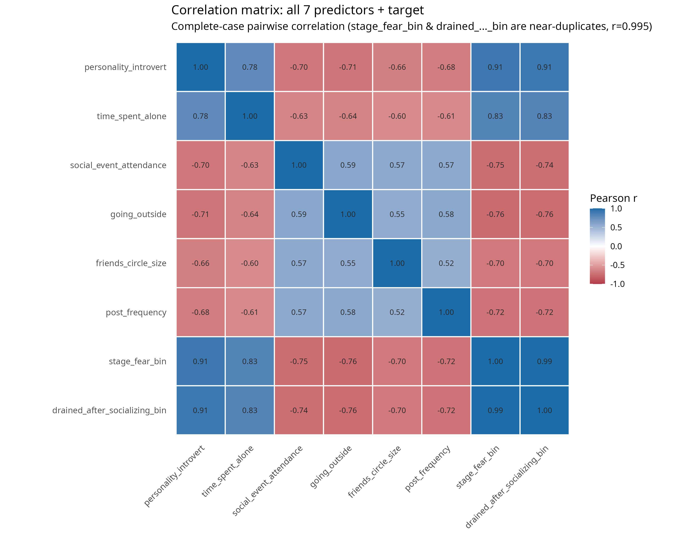
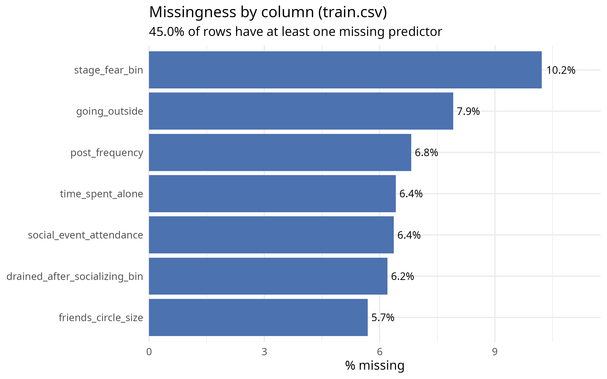
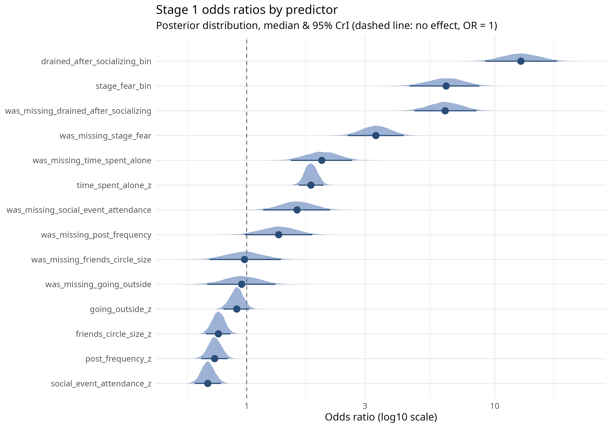
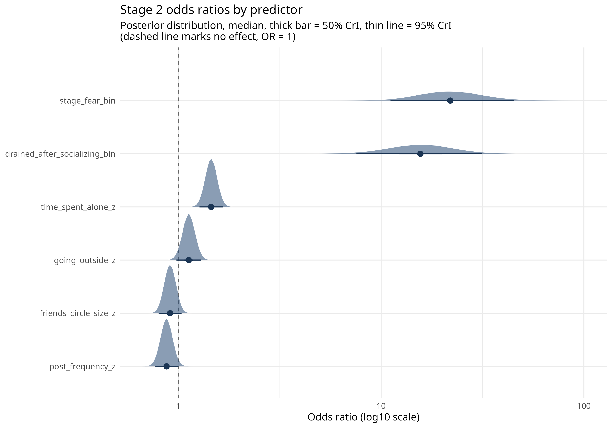

# Predict the Introverts from the Extroverts — Bayesian logistic regression with missing-data modeling

Kaggle competition: https://www.kaggle.com/competitions/playground-series-s5e7

## 1. Background

This project is part of the **Bayesian Kaggle Challenge**, a series of independent projects solved by using only **Bayesian Statistics**, where we focus on inference without giving up too much predictability.

This entry tackles [Predict the Introverts from the Extroverts](https://www.kaggle.com/competitions/playground-series-s5e7): given 7 self-reported behavioral features (time spent alone, social event attendance, going outside, friends circle size, post frequency, stage fear, drained after socializing), predict whether a person is `Introvert` or `Extrovert`. 18,524 training rows, scored by accuracy on the held-out set.

The dataset's defining feature — and the actual point of this project — is that it's full of holes: **45% of rows are missing at least one of the 7 predictors**. Most public notebooks for this competition just dropped or point-imputed those rows and moved on. We didn't, because "how do you honestly handle missing data" is a much more interesting Bayesian question than squeezing out one more decimal of accuracy on an already near-ceiling leaderboard.

## 2. Exploratory findings

Some observations:

- **Every one of the 7 predictors is unusually strongly correlated with the target** — |r| between 0.66 and 0.91, much stronger than a typical tabular dataset. This is *not* a hard classification problem in the usual sense.
- **`stage_fear_bin` and `drained_after_socializing_bin` are near-duplicates of each other** (r = 0.995) — whatever one of them says, the other almost certainly says the same thing. That turned out to matter a lot later on.
- Class balance is moderate, not extreme: **73.95% Extrovert / 26.05% Introvert**.

Missingness is spread across every column (5.7%–10.2% each), and it isn't random: rows missing `Stage_fear`, for example, are 39% Introvert vs. a 24.5% baseline among rows that answered it. That's a real MNAR (missing-not-at-random) signal — introverts are plausibly more likely to skip a self-report question about social anxiety — and it's exactly the kind of thing a naive `dropna()` throws away.

## 3. The modeling journey

We built this in two stages, and Stage 2 took three tries to get right. All the wrong turns are documented here on purpose — they're as informative as the final answer.

### Stage 1: a solid baseline

A single Bayesian logistic regression (`brms`, `bernoulli(link="logit")`) with **median/mode point imputation plus 7 `was_missing_*` indicator variables** — one per predictor, flagging whether that row originally had a gap there. Weakly-informative priors (`normal(0, 2.5)` on all coefficients — see "priors" below for why we ended up here). Straightforward, and it gives a real baseline to beat.

### Stage 2, attempt 1: model missingness explicitly inside `brms`

The ambitious version: a single `brms` multivariate model where each of the 7 partially-missing predictors gets its own sub-model via `mi()`, jointly estimated with the main classification model — genuine Bayesian imputation, with the missing values as latent parameters instead of point-imputed placeholders. This **fit cleanly** (Rhat 1.0035, zero divergences) after some real engineering (simplifying each sub-model from 6 cross-referenced predictors down to 2 to make it tractable, working around the fact that `brms`/Stan don't support `mi()` on binary/discrete responses at all).

Then it hit a wall we couldn't engineer around: `brms` cannot predict on **new** rows that have their own missing values when using `mi()`. The missing values from training are estimated as parameters that only exist for the training rows — there's no way to ask the fitted model "what would you say about this brand new incomplete row?" We confirmed this is a real, unresolved limitation (not our bug) via the `brms` maintainer's own replies on the Stan forum and GitHub issue #544. Since ~45% of our validation rows are exactly this "new incomplete row" case, this design was a dead end for anything except fitting the training set once. It's fully preserved on the git branch `checkpoint/joint-mi-stage2` if you want to see how far it got.

### Stage 2, attempt 2: external imputation (`mice`) + `brm_multiple()`, two models

Plan B: impute externally with `mice` (the standard multiple-imputation package), generate 20 completed copies of the training data, and fit the *same simple* `brms` model to each copy via `brm_multiple()` — which pools the 20 posteriors into one, properly propagating "how uncertain are we about the values we guessed" into the final answer. This sidesteps the `mi()`-on-new-data problem entirely, because a `brm_multiple()` fit is just an ordinary model — it can predict on anything, as long as that anything is also complete.

Except: for cross-validation, we needed to impute the *held-out* rows too, and included the training outcome as a predictor in `mice`'s imputation model (which is standard, legitimate multiple-imputation practice for training data, where the outcome is genuinely known). We used `mice(..., ignore = <holdout rows>)` to keep held-out rows out of the imputation model's *fitting*, but that doesn't stop a held-out row's own true label from leaking into *its own* imputed values — and `test.csv` never has a label at all, so this doesn't generalize. We only caught this on a full-branch code review, well after building and validating it.

The fix we landed on: **two models**. Model A, trained with the outcome included in imputation (legitimate — training labels are real), used only for rows with no missing predictors (no imputation happens at prediction time there, so no mismatch). Model B, trained with the outcome deliberately excluded from imputation, used for rows with missing predictors, imputed the same outcome-blind way both times. Every row gets routed to whichever model matches its own completeness.

### Stage 2, final: actually, just Model B

Once the two-model design was built and validated, we asked the obvious follow-up: how much is Model A actually buying us? We ran Model B on the *same* complete-row subset Model A was specifically built for, across all 5 CV folds, and compared AUC:

| Fold | AUC Model A | AUC Model B |
|---|---|---|
| 0 | 0.9494 | 0.9475 |
| 1 | 0.9455 | 0.9442 |
| 2 | 0.9277 | 0.9233 |
| 3 | 0.9471 | 0.9443 |
| 4 | 0.9418 | 0.9384 |
| **Pooled** | **0.9420** | **0.9393** |

Model A wins every fold, but by ~0.003 AUC — consistent, but tiny. Not worth carrying two models, two `mice()` passes, and completeness-based routing for. **So we deleted Model A** and kept Model B alone as the final Stage 2 design. It's also just simpler to use: the exact same trained model handles every row uniformly, whether it's complete, partially missing, or (the real `test.csv` case) entirely missing a label. `mice`'s imputation input for the one surviving model excludes `personality_introvert` entirely — not just "unused," the column isn't there at all — so there's structurally nothing left that could leak.

(As a side note: dropping the outcome from imputation did *not* pull the `stage_fear_bin`/`drained_after_socializing_bin` coefficients back down to Stage 1-ish levels the way we expected. We checked why — see "Priors and a surprising coefficient" below.)

## 4. Model

$$\text{personality\_introvert}_i \sim \text{Bernoulli}(p_i)$$

$$\text{logit}(p_i) = \beta_0 + \beta_1 \, \text{time\_alone}_i^z + \beta_2 \, \text{social\_event}_i^z + \beta_3 \, \text{going\_out}_i^z + \beta_4 \, \text{friends}_i^z + \beta_5 \, \text{posts}_i^z + \beta_6 \, \text{stage\_fear}_i + \beta_7 \, \text{drained}_i$$

Superscript $z$ = standardized (observed-value mean/SD). `stage_fear`/`drained` are already 0/1, not standardized. Same formula shape in both stages; Stage 1 additionally carries 7 `was_missing_*` indicator terms that Stage 2 doesn't need (it's genuinely imputed, not point-imputed-and-flagged).

### Priors, and a surprising coefficient

Our first instinct for priors was to read a directional nudge off each predictor's marginal correlation with the target. That was a mistake here. A **prior predictive check** (`sample_prior = "only"`, fit against no real data at all) showed a median predicted probability of **0.013** against an actual base rate of **0.26** — the prior alone was already extremely overconfident, before a single row of data was involved. The bug: these 7 predictors are strongly *mutually* correlated (not just correlated with the target), so five independently-large directional nudges compounded instead of adding independent information. Fix: drop the nudging, use a single flat, weakly-informative `normal(0, 2.5)` for every coefficient — the standard Gelman default for standardized-predictor logistic regression, letting the data (n = 18,524) do all the work. Re-running the check gave a median of **0.2606** against the true 0.2605. Lesson: always run the check before trusting a prior, even when the choice "should" be fine on paper.

The `stage_fear_bin`/`drained_after_socializing_bin` coefficients also turned out bigger than expected — odds ratios in the teens-to-thirties, vs. Stage 1's 6.4/12.7 for the same variables. Our first guess was that this was an artifact of imputing with the outcome available (Stage 1's Model A story, above). It wasn't, or at least not mostly: only ~10%/6% of these two columns are missing at all, so *both* models are fit predominantly on the ~90% of rows where they're genuinely observed — and a raw, imputation-independent 2×2 table on just the observed rows already shows an odds ratio around **670**. The size of the coefficient is mostly intrinsic to how strongly these two questions actually predict introversion in this (synthetic) dataset, not a modeling artifact. Because the pair is so collinear (r = 0.995), we report their **posterior sum** as the more stable quantity — Stage 2: 5.58 log-odds [5.09, 6.09], vs. Stage 1's 4.39 [4.03, 4.76].

## 5. Results

### Cross-validated performance

Both stages land in a near-ceiling accuracy band (~0.969) where accuracy alone can't really tell them apart — this competition's own leaderboard reportedly comes down to "about 10 data points." AUC, which uses the full probability ranking instead of a hard threshold, does separate them:

| | Folds | Pooled accuracy | Pooled AUC | Pooled Brier | Max R-hat | Min ESS |
|---|---|---|---|---|---|---|
| **Stage 1** | 10 | 0.9690 | 0.9592 | 0.0302 | 1.0060 | 1150 |
| **Stage 2** | 5 | 0.9690 | **0.9611** | 0.0296 | 1.0060 | 1149 |

Stage 2's fold count is lower than Stage 1's (5 vs. 10, `m=5` imputations vs. Stage 1 needing none) purely as a compute compromise — CV is for sanity-checking and this comparison, not the final inference. The pooled figures (computed on the full concatenated out-of-fold predictions, independent of fold count) are what should be compared. `brm_multiple()` fits (Stage 2) can't use a combined R-hat the way a normal `brmsfit` can — it's checked per-imputation instead (`posterior::as_draws_array()` + `subset_draws()`), and the worst value across all 20 imputations is what's reported above.

### Odds ratios

Stage 1:

Stage 2:

`stage_fear_bin` and `drained_after_socializing_bin` dominate both models by a wide margin — no surprise given the ~0.91 raw correlation with the target. `time_spent_alone` is the strongest of the 5 count-like predictors in both stages; a couple of the weaker ones (`going_outside`, `friends_circle_size`) have credible intervals crossing 1 in Stage 2, an honest "no clearly detectable effect net of everything else" result rather than something to hide.

### Calibration

The two extreme bins — where the bulk of the data actually lives, since this problem is close to separable — sit right on the diagonal. The middle bins wobble more, but that's small-sample noise, not a systematic bias: most predicted probabilities cluster near 0 or 1, so the mid-range bins each hold relatively few out-of-fold points.

### Posterior predictive check

Pooled across all 20 imputations (not just the first, which is what `brms`'s own `pp_check()` silently does by default on a `brm_multiple` object unless you pass explicit `newdata` — another thing we had to catch and fix manually). Simulated 0/1 proportions match the observed split closely.

## 6. What we'd do differently

- **Run the prior predictive check before, not after, assuming a prior is fine "because it worked on the last project."** The compounding failure above cost real iteration time.
- **Think about what information a real test row will and won't have, from the start**, rather than discovering a CV-time leakage issue after a full whole-branch review. The `mice(ignore=)` mistake wasn't a bug in the narrow sense — the code did what it was told — it just wasn't told the right thing.
- **Check whether an added layer of complexity earns its keep before committing to it**, not after. The two-model split was principled and worked, but a five-minute AUC comparison would have shown its actual value (~0.003 AUC) earlier.

## Repository layout

- `src/features.R` — shared feature engineering: `read_competition_csv()` (fixes a real `fread()`/`read.csv()` gotcha — blank fields in character columns read as `""`, not `NA`, unless told otherwise), `recode_personality()`, `prepare_stage1_data()`, `prepare_stage2_data()`, standardization/imputation helpers, stratified folds
- `src/metrics.R` — hand-written accuracy/AUC/Brier score (no new dependency)
- `src/model_spec_stage1.R`, `src/model_spec_stage2.R` — formula, family, priors (single source of truth per stage)
- `src/prior_predictive_check_stage1.R` — the check that caught the compounding-prior bug
- `src/fit_stage1_cv.R`, `src/fit_stage1_full.R` — Stage 1 cross-validation and final fit
- `src/fit_stage2_full.R`, `src/fit_stage2_cv.R` — Stage 2 (`mice` + `brm_multiple()`) final fit and cross-validation
- `src/report_stage1_inference.R`, `src/report_stage2_inference.R` — posterior odds ratios + forest plots
- `src/check_calibration_stage1.R`, `src/check_calibration_stage2.R` — reliability diagrams
- `src/check_diagnostics_stage1.R`, `src/check_diagnostics_stage2.R` — Rhat/ESS/`pp_check`
- `src/compare_stages.R` — Stage 1 vs. Stage 2 accuracy/AUC comparison
- `src/compare_modelA_modelB_on_complete_rows.R` — historical: the AUC check that led to dropping Model A (not re-runnable against the current pipeline, kept as a decision record)
- `src/plot_eda.R` — the two exploratory figures at the top of this README
- `tables_figures/` — all figures and summary tables referenced above
- `checkpoint/joint-mi-stage2` (git branch, not a folder) — the fully-built, fully-fit joint-`mi()` design from Stage 2 attempt 1, kept for reference
