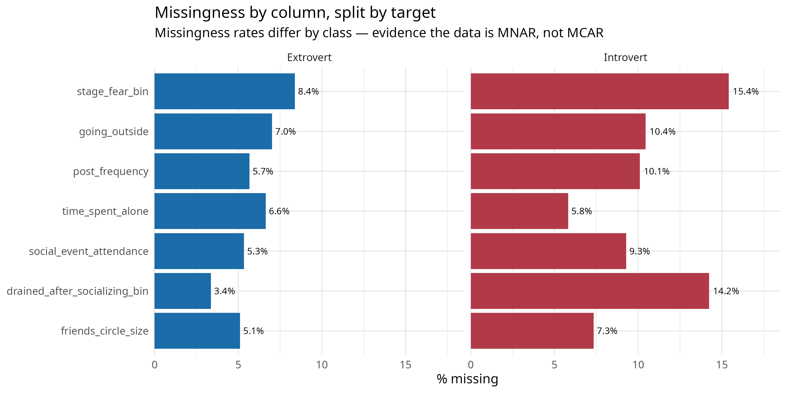
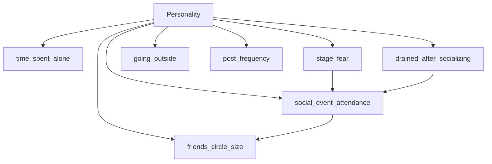
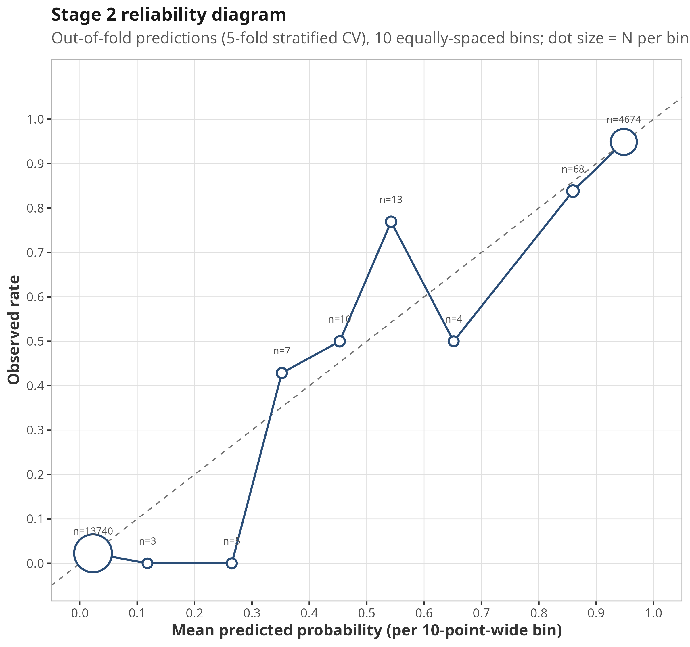
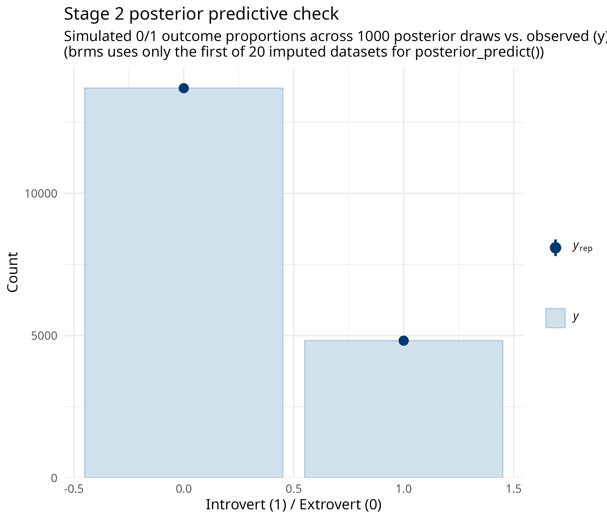

# Predict the Introverts from the Extroverts — Bayesian logistic regression with missing-data modeling

Kaggle competition: https://www.kaggle.com/competitions/playground-series-s5e7

## 1. Background

This project is part of the **Bayesian Kaggle Challenge**, a series of independent projects solved by using only **Bayesian Statistics**, where we focus on inference without giving up too much predictability.

This entry tackles [Predict the Introverts from the Extroverts](https://www.kaggle.com/competitions/playground-series-s5e7): given 7 self-reported behavioral features (time spent alone, social event attendance, going outside, friends circle size, post frequency, stage fear, drained after socializing), predict whether a person is `Introvert` or `Extrovert`. 18,524 training rows, scored by accuracy on the held-out set.

The dataset's defining feature is that missing data is everywhere: **45% of rows are missing at least one of the 7 predictors**. Most public notebooks for this competition just dropped or point-imputed those rows and moved on. We didn't, because "how do you honestly handle missing data" is a much more interesting Bayesian question than squeezing out one more decimal of accuracy on an already near-ceiling leaderboard.

## 2. Exploratory findings

Some observations:

- **Every one of the 7 predictors is strongly correlated with the target** — |r| between 0.66 and 0.91, much stronger than a typical tabular dataset. This is *not* a hard classification problem in the usual sense.
- **`stage_fear_bin` and `drained_after_socializing_bin` are near-duplicates of each other** (r = 0.995).
- There's some moderate class inbalance: **73.95% Extrovert / 26.05% Introvert**.

Missingness is spread across every column (5.7%–10.2% each), and it isn't random: rows missing `Stage_fear`, for example, are 39% Introvert vs. a 24.5% baseline among rows that answered it — a real MNAR signal that biases any model that just drops missing rows.

## 3. Approach

We built this in two stages: a causal analysis that decides which predictors belong in the model, then the model itself.

**Stage 1** treats `Personality` as a latent trait and the 7 behavioral columns as its effects, not its causes — an introvert *tends to* spend more time alone, not the reverse. We drew an explicit causal DAG on that basis and tested it: for each plausible behavior-to-behavior edge (e.g. does `friends_circle_size` carry signal about `Personality` beyond what `social_event_attendance` already captures, or is it fully mediated?), we compared a predictor's `glm()` coefficient with and without the candidate conditioning variable — by effect size, not p-value, since these predictors are collinear enough that p-values are a poor guide to what's actually redundant.

*`social_event_attendance` and `friends_circle_size` are colliders (multiple parents) — see the collider caveat below.*

**Stage 2** is a Bayesian logistic regression (`brms`, `bernoulli(link="logit")`) on the 6-predictor set Stage 1 recommends (see "Stage 1 findings" below), fit with proper multiple imputation: `mice` generates 20 completed copies of the data, and `brm_multiple()` fits the same model to each copy and pools the posteriors, so the final uncertainty reflects both the usual sampling noise and "how sure are we about the values we guessed." The outcome is deliberately excluded from `mice`'s imputation model — not just unused, structurally absent — so the same fitted model can be applied uniformly to any row, complete or not, including `test.csv` rows that never have a label at all.

Two earlier Stage 2 designs didn't make the cut: a fully joint `brms` model using `mi()` for each missing predictor fit cleanly but turned out unable to predict on new rows that have their own missing values. A follow-up two-model split (one model trained with the outcome available for imputation, used only on complete rows) fixed a subtler leakage problem but, once measured, only bought ~0.003 AUC over the single outcome-free model, which was not worth the extra complexity, so we dropped it.

## 4. Model

$$\text{personality\_introvert}_i \sim \text{Bernoulli}(p_i)$$

$$\text{logit}(p_i) = \beta_0 + \beta_1 \, \text{time\_alone}_i^z + \beta_2 \, \text{going\_out}_i^z + \beta_3 \, \text{friends}_i^z + \beta_4 \, \text{posts}_i^z + \beta_5 \, \text{stage\_fear}_i + \beta_6 \, \text{drained}_i$$

Superscript $z$ = standardized (observed-value mean/SD). `stage_fear`/`drained` are already 0/1, not standardized. This is Stage 2's formula, now using the 6-predictor set Stage 1 recommends (`social_event_attendance` dropped) — Stage 2 is the only fitted predictive model; Stage 1 doesn't fit anything, it recommends which terms belong here, and this re-fit acts on that recommendation (see "Stage 1 findings" below and "Approach" above).

### Priors, and a surprising coefficient

Defining directional priors would have been a challenge, specially because many of the predictors were strongly correlated to each other. Because of this we use a single flat, weakly-informative `normal(0, 2.5)` for every coefficient, letting the data (n = 18,524) do all the work. The **prior predictive check** gave a median of **0.2606** against the true 0.2605, validating our prior defintion.

The `stage_fear_bin`/`drained_after_socializing_bin` coefficients turned out bigger than a naive collinearity story would predict. Part of the explanation is structural: `social_event_attendance` is a **collider** in Stage 1's DAG (it has three parents — `Personality`, `stage_fear_bin`, `drained_after_socializing_bin`), and including a collider as a covariate alongside its co-parents can inflate the estimated association between those co-parents and the outcome beyond their true shared-cause relationship — a real caveat for interpreting `stage_fear_bin`/`drained_after_socializing_bin`'s coefficients in the retired 7-predictor fit, which did include `social_event_attendance` as a covariate. The current 6-predictor Stage 2 drops `social_event_attendance` entirely (per Stage 1's separate mediation check below, not because of this collider concern), which removes that specific inflation mechanism — yet the `stage_fear_bin`/`drained_after_socializing_bin` posterior sum barely moved (5.58 → 5.84 log-odds, intervals overlapping substantially), suggesting collider-conditioning wasn't the dominant driver of their size after all, and the effect is largely intrinsic. Separately: only ~10%/6% of these two columns are missing at all, so both models are fit predominantly on the ~90% of rows where they're genuinely observed — and a raw, imputation-independent 2×2 table on just the observed rows already shows an odds ratio around **670**. Because the pair is so collinear (r = 0.995), we report their **posterior sum** as the more stable quantity — Stage 2: 5.84 log-odds [5.39, 6.30], vs. the retired baseline model's 4.39 [4.03, 4.76].

### Stage 1 findings: which predictors survive the DAG check

The DAG-motivated checks target specific edges the causal graph predicts:

- `stage_fear_bin`'s coefficient retains 56.3% of its bivariate magnitude when `drained_after_socializing_bin` is added as a conditioning variable, consistent with the DAG's prediction that they're parallel effects of `Personality`, not mediators of each other. This feature is kept.
- Symmetrically, `drained_after_socializing_bin`'s coefficient retains 43.1% of its bivariate magnitude when conditioned on `stage_fear_bin`, same story from the other direction. This feature is kept.
- `social_event_attendance_z`'s coefficient retains only 6.6% of its bivariate magnitude once conditioned on `stage_fear_bin` and `drained_after_socializing_bin` together, its raw association with `Personality` (odds ratio 0.034 alone) collapses to near-null (odds ratio 0.80 conditioned), matching the DAG's mediation edge: `social_event_attendance` doesn't carry signal about `Personality` beyond what those two already capture. This feature is dropped.
- `friends_circle_size_z`'s coefficient retains 51.1% of its bivariate magnitude when conditioned on `social_event_attendance_z` alone, it survives this targeted check, so its own DAG-relevant conditioning doesn't explain it away. This feature is kept.

A separate, blunter **general screen** conditions each of the 7 predictors on all 6 others simultaneously (7 rows, `check == "general_screen"` in the CSV). There, 5 of 7 predictors — including `friends_circle_size_z` (down to 5.0% retained, odds ratio 0.048 alone vs. 0.86 conditioned) — come out as drop candidates, because `stage_fear_bin` and `drained_after_socializing_bin` are so dominant (raw bivariate odds ratios around 670 each) that they swamp everyone else's marginal contribution once all 7 compete at once. This is "dominant predictor" crowding-out, not mediation, and it's exactly why the design spec treats the general screen as supporting context rather than the primary decision: `friends_circle_size_z` genuinely disagrees between the two check types — "keep" against the one variable the DAG says it should be checked against, "drop candidate" against a screen that also includes two variables an order of magnitude stronger than it. We trust the targeted DAG check here and keep it.

**Overall outcome:** `social_event_attendance_z` is the one predictor the DAG-motivated checks flag as a drop candidate; the other 6 (`time_spent_alone_z`, `going_outside_z`, `friends_circle_size_z`, `post_frequency_z`, `stage_fear_bin`, `drained_after_socializing_bin`) are kept. Stage 2 below has been re-fit on this reduced 6-predictor set, acting on this recommendation.

Full results, including the general 7-predictor screen: `tables_figures/stage1_dag/coefficient_shift_checks.csv`.

## 5. Results

### Cross-validated performance

Stage 2 (the only fitted predictive model now — see "Approach" above) lands in a near-ceiling accuracy band (~0.969), where this competition's own leaderboard reportedly comes down to "about 10 data points":

| | Folds | Pooled accuracy | Pooled AUC | Pooled Brier | Max R-hat | Min ESS |
|---|---|---|---|---|---|---|
| **Stage 2** | 5 | 0.9690 | 0.9613 | 0.02962 | 1.0081 | 1031.6 |

`brm_multiple()` fits can't use a combined R-hat the way a normal `brmsfit` can — it's checked per-imputation instead (`posterior::as_draws_array()` + `subset_draws()`), and the worst value across all 20 imputations is what's reported above.

### Leaderboard

The competition is scored on plain **Accuracy** (`sample_submission.csv` format: `id, Personality`). We submitted the final Stage 2 model's predictions on `test.csv` (`src/generate_submission.R` + `src/submit_to_kaggle.py`):

| | Score |
|---|---|
| Our submission — public | 0.974089 |
| Our submission — **private (final ranking metric)** | **0.968421** |
| Leaderboard's best private score | 0.9706 |

0.968421 vs. 0.9706 is about 0.22 points — close to the top of a competition with thousands of entries, most almost certainly heavily-tuned tree/ensemble blends, from a single interpretable Bayesian logistic regression. It's also consistent with our own CV estimate (0.9690 pooled accuracy), which sits right between the two: no sign of a CV/leaderboard mismatch or overfitting to the training folds.

**A genuine anomaly, worth stating plainly:** this 6-predictor submission's public/private scores are identical to 6 decimal places to the retired 7-predictor Stage 2 submission's scores (public 0.974089, private 0.968421 either way), even though only 2 of 6,175 `test.csv` predictions actually differ between the two models. This was double-checked, not a stale-result artifact — Kaggle's submission history shows two distinct entries with different refs and timestamps (`54864960` on 2026-07-21 for this 6-predictor run, `54794354` on 2026-07-17 for the prior 7-predictor run), both genuinely scored. The most likely explanation: with only 2/6,175 rows changing, whichever rows differ apparently didn't land in a position that shifts either scored subset's accuracy once rounded to 6 decimals — plausible for such a small prediction delta, not evidence of a bug.

### Odds ratios

`stage_fear_bin` and `drained_after_socializing_bin` dominate by a wide margin — no surprise given the ~0.91 raw correlation with the target, and confirmed by Stage 1's coefficient-shift checks to carry independent signal rather than redundancy. `time_spent_alone` is the strongest of the 4 remaining count-like predictors (odds ratio 1.450, 95% CrI [1.270, 1.656], clear of 1); the other three (`going_outside`, `friends_circle_size`, `post_frequency`) have 95% credible intervals crossing 1 — `post_frequency` only just (upper bound 1.00) — an honest "no clearly detectable effect net of everything else" result rather than something to hide.

### Calibration

The two extreme bins — where the bulk of the data actually lives, since this problem is close to separable — sit right on the diagonal. The middle bins wobble more, but that's small-sample noise, not a systematic bias: most predicted probabilities cluster near 0 or 1, so the mid-range bins each hold relatively few out-of-fold points.

### Posterior predictive check

Pooled across all 20 imputations (not just the first, which is what `brms`'s own `pp_check()` silently does by default on a `brm_multiple` object unless you pass explicit `newdata` — another thing we had to catch and fix manually). Simulated 0/1 proportions match the observed split closely.

## Repository layout

- `src/features.R` — shared feature engineering: `read_competition_csv()` (fixes a real `fread()`/`read.csv()` gotcha — blank fields in character columns read as `""`, not `NA`, unless told otherwise), `recode_personality()`, `prepare_stage1_data()`, `prepare_stage2_data()`, standardization/imputation helpers, stratified folds
- `src/metrics.R` — hand-written accuracy/AUC/Brier score (no new dependency)
- `src/stage1_dag_analysis.R` — the new Stage 1: defines and plots the causal DAG (`ggdag`), runs the `glm()`-based coefficient-shift checks that recommend which predictors Stage 2 should use (acted on — Stage 2 now fits the recommended 6-predictor set)
- `src/model_spec_stage2.R` — formula, family, priors (single source of truth)
- `src/fit_stage2_full.R`, `src/fit_stage2_cv.R` — Stage 2 (`mice` + `brm_multiple()`) final fit and cross-validation
- `src/report_stage2_inference.R` — posterior odds ratios + forest plot
- `src/check_calibration_stage2.R` — reliability diagram
- `src/check_diagnostics_stage2.R` — Rhat/ESS/`pp_check`
- `src/generate_submission.R` — imputes `test.csv` the same outcome-free way as training and writes `data/processed/submission_stage2.csv`
- `src/submit_to_kaggle.py` — submits that file via the `kaggle` package's `KaggleApi` and prints back the scored result
- `src/plot_eda.R` — the two exploratory figures at the top of this README
- `src/old/` — retired code kept only as a decision record, not part of the active pipeline (e.g. `compare_modelA_modelB_on_complete_rows.R`, the AUC check that led to dropping Model A; the original Stage 1 baseline model and its `compare_stages.R` comparison, superseded 2026-07-20 by the causal DAG analysis)
- `tables_figures/` — all figures and summary tables referenced above
- `checkpoint/joint-mi-stage2` (git branch, not a folder) — the fully-built, fully-fit joint-`mi()` design that predated the `mice`/`brm_multiple()` approach, kept for reference
